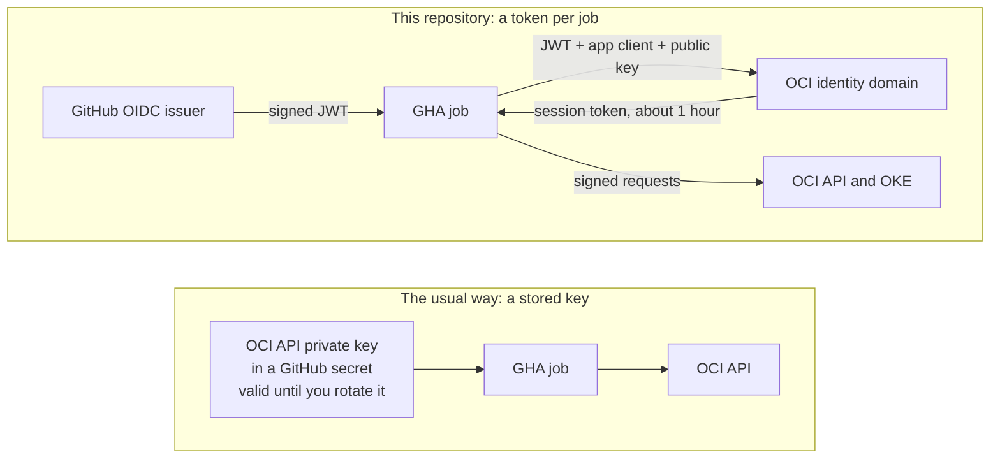
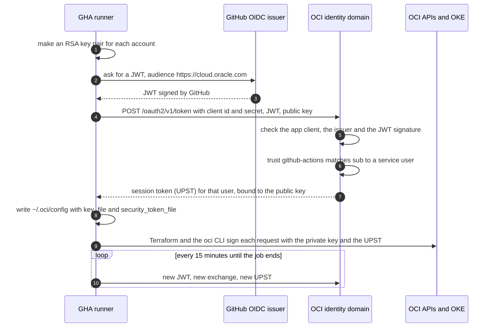
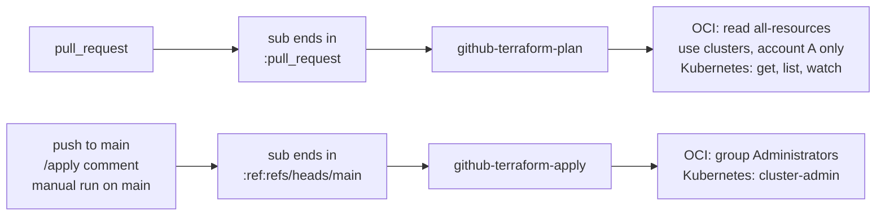
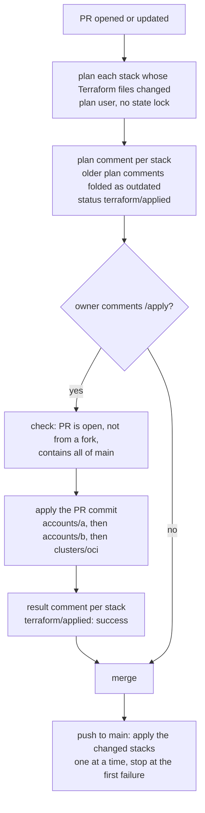
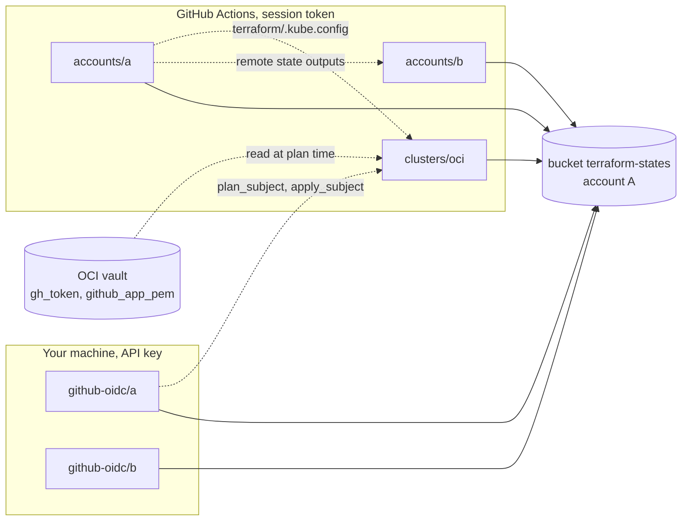

# How GitHub Actions logs in to OCI

The workflow [terraform.yml](../../.github/workflows/terraform.yml) runs Terraform against two OCI accounts and the OKE cluster. GitHub stores no OCI API key. Each job proves who it is with a token that GitHub signs, and OCI gives it a session token for one hour.

The stack [a](a/) in this folder holds the login of account A. The stack [b](b/) holds the login of account B, if you use account B. You apply them on your machine, see [Why these stacks are local](#why-these-stacks-are-local).

## What OIDC does

OIDC (OpenID Connect) is a standard way for one system to prove an identity to another system with a signed token. In this setup, GitHub is the identity provider. For each job, GitHub signs a JSON Web Token (JWT). The JWT says which repository, branch and event started the job. OCI checks the signature with the public keys that GitHub publishes. OCI never needs a password from GitHub.



A stored API key works for anyone who copies it. A session token works only for one hour, and only together with a private key that never leaves the runner.

The JWT has three claims that matter here:

| Claim | Meaning | Value |
| --- | --- | --- |
| `iss` | Who signed the token | `https://token.actions.githubusercontent.com` |
| `aud` | Who the token is for | `https://cloud.oracle.com` |
| `sub` | Who the job is | `repo:<owner>/<name>:pull_request` |

A repository with immutable subjects has the owner ID and the repository ID in the `sub` claim, for example `repo:<owner>@<owner_id>/<name>@<repo_id>:pull_request`. If someone renames that repository or makes a new one with the same name, the IDs do not match. Set `subject_prefix` in `terraform.tfvars` to the part before `:pull_request`.

## The login, step by step

The script [oci-session.sh](../../.github/scripts/oci-session.sh) does the login before Terraform starts. It logs in to account A. If the variable `OCI_TENANCY_B` is set, it also logs in to account B, because `accounts/b` uses both accounts.



UPST (user principal session token) is the OCI session token of a user. The identity domain is the user directory of each OCI account.

The exchange needs three things. Each one alone gives no access:

1. The JWT. Only a job of this repository can get one, and it expires after a few minutes.
2. The client ID and client secret of the app `github-terraform`. These are the GitHub secrets `OCI_CLIENT_A` and, with account B, `OCI_CLIENT_B`. OCI requires a confidential app for the exchange.
3. The public key. OCI binds the UPST to it, so the UPST is useless without the private key on the runner.

The script writes the profile `DEFAULT` for account A into `~/.oci/config`, and the profile `account_b` for account B. These are the same names as on your machine, so each stack runs in CI without profile overrides.

## Plan user and apply user

The trust `github-actions` in each identity domain has two rules. The rule that matches the `sub` claim selects the service user. A service user has no password and no API keys. It can only get session tokens.



A `/apply` comment runs the workflow file of `main`, so its `sub` ends in `:ref:refs/heads/main`. The workflow accepts the comment only from the repository owner.

OKE uses the `sub` claim as the Kubernetes user name. So [clusters/oci/github-oidc.tf](../clusters/oci/github-oidc.tf) binds the Kubernetes roles to the outputs `plan_subject` and `apply_subject` of the stack `a`, not to the user OCIDs.

## From PR to apply



A manual run (Actions > terraform > Run workflow) can also plan or apply one stack. The [Terraform README](../README.md#ci) has the details of `/apply` and the status `terraform/applied`.

## The five stacks



Solid lines show where each stack keeps its state. Dotted lines show what a stack reads from another place.

### Why these stacks are local

The stacks `a` and `b` hold the CI login: the trust, the app, the two service users and the plan policy. CI does not plan or apply them, for two reasons:

1. The plan user cannot read the trust. The identity domain has no read-only role for trusts.
2. A bad CI apply of the login can lock CI out, and then only a local run can fix it.

You change these stacks almost never. To change one, run `terraform plan` and `terraform apply` in its folder with your API key. If you change the outputs of `a`, run `terraform apply` in `clusters/oci` after it.

To get the value for a GitHub secret again, run this in the folder of the stack:

```
gh secret set OCI_CLIENT_A --body "$(terraform output -json github_oidc | jq -r .client_id):$(terraform output -raw github_oidc_client_secret)"
```

In `b`, use `OCI_CLIENT_B`.

## Limits

1. A session token lives about one hour, and the script gets a new one every 15 minutes. An apply that runs longer than one hour also needs Terraform to read the new token file. No apply in this repository takes that long, so this is not tested.
2. The status `terraform/applied` is pending while a PR has changes that are not applied. It blocks the merge only as a required status check. A private repository on GitHub Free cannot require status checks.
